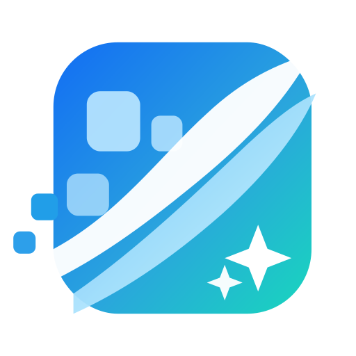

# 净屏 ClearScreen

<p align="center">
  
</p>

<p align="center"><strong>净化屏幕，专注生活</strong></p>

净屏是一款以 Android 为主要平台的广告辅助工具。它通过用户授权的无障碍服务，在已启用的应用中识别部分明确的广告跳过或关闭控件；也提供系统推荐开关、应用通知和营销通知管理入口。

净屏采用谨慎处理策略：识别证据不足、控件不明确或系统页面无法核实时，会跳过操作。它不能保证清除所有广告，也不会替代用户作出系统设置授权。

[项目仓库](https://github.com/Ronnie-Jiao/ClearScreen) · [隐私政策](docs/wiki/隐私政策.md) · [修改记录](docs/wiki/CHANGELOG.md)

## 功能概览

- **广告跳过与关闭**：在用户启用的应用中，识别高置信度的跳过广告控件和带有明确广告语境的关闭控件。
- **学习关闭**：用户可以在目标应用中选择关闭控件并保存规则。规则根据控件和所在广告区域的结构匹配，不保存屏幕坐标；页面变化或无法唯一确认目标时不会执行。
- **系统广告整理**：在适配的设备上检查系统推荐开关，并引导用户进入对应系统设置。可用项目取决于品牌、系统版本和设备上实际存在的设置入口。
- **通知管理**：提供应用通知和营销通知页面。读取或修改完整通知渠道、管理部分系统广告组件，需要用户主动授权 ADB Shell 或 Shizuku；可用范围因设备而异。
- **处理记录与应用规则**：查看处理结果、管理应用启用状态，并管理学习关闭规则。
- **APP 使用说明**：设置中的“帮助与反馈”按 Android/iOS 展示对应功能说明和问题排查；可搜索标题、正文和关键词，点选结果直达相关功能页，返回后保留搜索条件。

## 平台支持

| 平台 | 当前能力 | 范围说明 |
| --- | --- | --- |
| Android | 主要开发平台；无障碍广告处理、学习关闭、系统推荐与通知管理 | 需要用户逐项授权。广告识别和厂商设置兼容性受应用界面、无障碍节点及系统版本影响。 |
| iOS | Safari 网页扩展 | 仅在用户启用扩展并授权的网站中运行；不跨 App 读取屏幕。系统级广告过滤尚未接入。 |
| Web | `public/` 中保留早期交互原型 | 不是当前 Android/iOS 应用的完整 Web 版本。 |
| HarmonyOS | 独立目录中的 UI 复用试验 | 尚未实现鸿蒙无障碍服务、应用管理和广告处理，不能作为可用版本。 |

## 工作方式与权限

Android 的广告处理依赖系统无障碍服务。启用后，服务会读取当前应用中可访问的界面结构；在支持的场景下，也会结合设备端截图文字识别来判断广告区域。操作只在用户同意隐私政策、开启服务和总开关，并且目标应用规则处于启用状态时进行。

系统推荐开关及通知渠道等功能可能需要用户主动连接 ADB Shell 或授权 Shizuku。净屏不会获取 Root 权限，也不会申请、创建或接管系统 VPN。系统设置是否可读写取决于品牌和系统版本；应用会在无法确认目标时停止操作。

应用规则、学习规则、处理记录和偏好设置保存在本机。净屏不会保存广告截图或识别出的页面文字；Google ML Kit 可能联系 Google 服务获取组件信息并发送诊断/使用指标。应用只会在用户主动检查公开版本信息时访问 GitHub。完整的数据处理范围见[隐私政策](docs/wiki/隐私政策.md)。

## 获取与开发

### 安装 Android 版本

如仓库已发布安装包，可从 [GitHub Releases](https://github.com/Ronnie-Jiao/ClearScreen/releases) 获取。更新时请覆盖安装，保持原包名和发布签名，以保留本机数据；不要先卸载旧版本。

### 本地运行

需要 Node.js、npm、Android Studio/Android SDK 和可用的 Android 设备或模拟器。

```bash
npm install
npm run android
```

启动 Expo 开发服务：

```bash
npm run start
```

正式 APK 的签名、版本递增、构建和安装步骤见[构建与安装 Wiki](docs/wiki/README.md#5-apk-构建与安装约定)。请勿将发布密钥或签名配置提交到仓库。

## 文档

- [项目 Wiki：架构、功能边界、权限与构建说明](docs/wiki/README.md)
- [修改记录](docs/wiki/CHANGELOG.md)
- [隐私政策](docs/wiki/隐私政策.md)
- [权限状态核验与品牌说明](docs/wiki/权限状态核验.md)
- [应用商店合规核查](docs/wiki/应用商店合规核查.md)

## 项目结构

```text
ClearScreen/
├─ App.tsx                  # React Native 应用入口
├─ src/                     # 页面、组件、主题与原生模块适配
├─ android/                 # Android 原生服务与平台集成
├─ targets/safari/          # Safari Web Extension
├─ targets/harmony-pilot/   # 隔离的 HarmonyOS UI 复用试验
├─ targets/harmony-bare-pilot/ # 独立的 HarmonyOS 页面复用试验
├─ public/                  # 早期 Web 原型
└─ docs/wiki/               # 项目 Wiki、隐私与修改记录
```

## 许可证

仓库目前没有附带 `LICENSE` 文件。添加许可证前，源码的复制、修改和再分发权限尚未通过本仓库明确授予。
