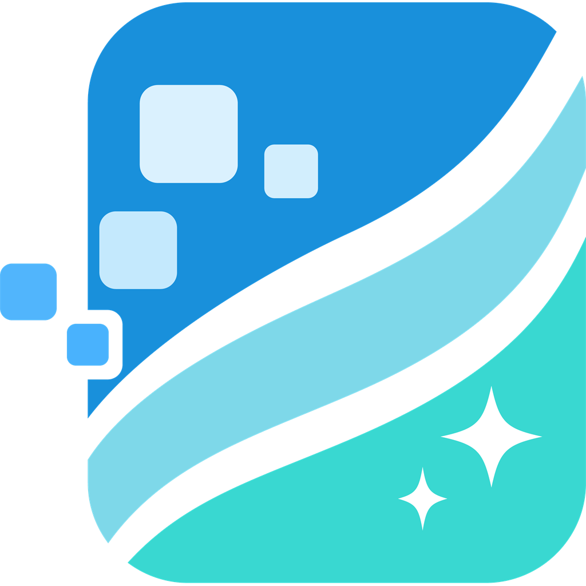

# 净屏 | ClearScreen

  

<strong>净化屏幕 畅享生活</strong> Clean your screen. Enjoy life.

<a href="#简体中文">简体中文</a> · <a href="#english">English</a>

## 简体中文

净屏（ClearScreen）是一款以 Android 为主要平台的广告辅助工具。用户开启无障碍服务后，应用可以在用户启用的应用中识别部分广告跳过和关闭控件。应用还提供系统推荐设置、应用通知管理和营销通知渠道的管理入口。

净屏只在目标明确时操作。识别证据不足、控件存在歧义或无法核验系统页面时，会跳过操作。它不能保证清除所有广告，也不会代替用户授予系统权限。开启无障碍时会直接打开 Android 系统设置；部分 Android 版本可能还要求你在应用信息中手动允许受限设置。

[GitHub 项目仓库](https://github.com/Ronnie-Jiao/ClearScreen) · [隐私政策](docs/wiki/隐私政策.md) · [修改记录](docs/wiki/CHANGELOG.md)

### 功能

- **广告跳过与关闭：** 在用户启用的应用中结合无障碍树结构和组合语义识别跳过、关闭、拒绝优惠等表达，覆盖“略过”“关掉”“残忍离开”“No thanks”等不同写法，不依赖封闭的精确词表。委婉拒绝/稍后再说等语义仍需同一局部广告标记或广告结构，且所有动作都必须对应真实、独立的无障碍控件。通用结构路径无需 OCR：同一子树必须含有明确广告资源 ID 或广告容器类名、较大的图片/视频创意，以及尺寸受限且真实可点击的独立控件。同一创意旁的“广告/推广/赞助”标记本身就足以确认广告语境，不再要求 CTA 文案。全屏开屏在同屏识别到广告标记、右上角紧凑“跳过”和下方跳转提示后，会立刻尝试点击；如果倒计时仍未结束，会有限重扫，并在可跳过时再尝试一次。全屏/播放器中的普通 X 仍需要更强证据；播放器里的委婉拒绝也必须有邻近广告标记。权限、播放、购买、订阅和举报/反馈操作不会被当作关闭广告；屏幕其他位置的广告字样、单独的角落 X 或大图都不触发。对界面树没有暴露足够结构的素材仍保留少量窄范围规则，例如 WiFi 万能钥匙悬浮促销、王者荣耀 KPL 海报、欧派奖励弹层和腾讯视频右下角促销。
- **学习关闭：** 进入选择模式后，净屏标记当前页面可访问的交互控件，已启用的自动关闭规则继续工作。用户点广告关闭控件对应的标记后，净屏优先按该按钮身份和就近容器生成局部规则，支持在同一窗口内重新定位移动的按钮，以及“关闭”“×”等同类关闭标签的变化；其它区域的歌词、进度、文字刷新和滚动不参与这类规则的匹配。执行前重新读取、唯一匹配并刷新真实目标，按当前节点操作；确认关闭并在本机保存规则后，学习模式和“选择控件 / 取消”工具栏会继续保留，用户可重复选择控件；完成后点“取消”退出学习。读取失败或超时会恢复“选择控件”，可以重试或取消；读取成功后再显示当前可见控件。再次打开应用时优先检查已学规则。页面保护检查与控件匹配共用一次读树，查找期间的定时重扫避免重复生成整页快照。旧规则继续读取，信息不足的旧规则在结构变化后可能需要重新学习。
- **系统广告设置：** 检查受支持的系统推荐设置，并引导用户进入对应系统页面。可用开关取决于设备品牌、系统版本和设备上实际存在的设置页面。
- **通知管理：** 提供应用通知管理和营销通知渠道页面。应用级通知状态按当前 Android 用户读取和修改，并在操作后回读确认；未连接或读取不完整时明确显示未知状态并提供重试或连接入口，不把未知状态当作关闭。读取或修改完整通知渠道数据，以及管理部分系统广告组件，需要用户授权 ADB Shell 或 Shizuku。设备支持情况各不相同。
- **处理记录与排除应用：** 查看处理结果、管理自动处理范围，并管理学习关闭规则。
- **应用内使用说明：** “使用说明”介绍 Android/iOS 功能并提供问题排查。可以搜索标题、正文和关键词，再从结果跳转到相关应用页面。

### 平台支持

| 平台 | 当前能力 | 范围与限制 |
| --- | --- | --- |
| Android | 主要开发平台；基于无障碍服务的广告辅助、学习关闭、系统推荐设置和通知管理 | 需要用户逐项授权。识别及厂商设置兼容性受应用界面、无障碍节点和系统版本影响。 |
| iOS | Safari 网页扩展 | 仅在用户启用扩展并授权的网站中运行；不跨 App 读取屏幕。尚未接入系统级广告过滤。 |
| Web | 早期交互原型，位于 public/ 目录 | 不是 Android/iOS 应用的完整 Web 版本。 |
| HarmonyOS | 隔离的界面复用试验 | 尚未实现鸿蒙无障碍服务、应用管理和广告处理；这些试验不是可用的应用版本。 |

### 权限、安全与隐私

Android 广告辅助功能依赖系统无障碍服务。开启后，服务会读取当前应用中可访问的界面结构；在支持的场景下，也可能使用设备端截图文字识别判断广告语境。只有用户开启服务和总开关，并且目标应用规则处于启用状态时，服务才会操作。应用内不再展示首次启动隐私政策同意页或政策阅读页；政策正文以仓库文档和公开页面提供。

Android 首次打开直接进入首页。点首页“去开启”或“设置 → 服务与权限”中的“自动跳过广告”，会使用同一确认提示并打开系统无障碍设置；返回应用后自动核验服务状态。系统保留开启状态但服务未连接或核验不可用时，会提示在系统设置中重新开启，并检查自启动、后台运行和电池限制。无障碍服务的重新绑定由 Android 管理。

系统推荐设置和通知功能可能需要用户连接 ADB Shell 或授权 Shizuku。净屏不使用 Root 权限，也不会创建、接管或依赖系统 VPN。系统设置能否读取或修改取决于设备品牌和系统版本；应用无法确认目标时会停止操作。

Android 应用名称和图标等元数据在内存缓存60秒，安装/卸载及相关配置变化时失效；用户应用规则仍实时读取。完整快照、操作命令、权限与服务健康检查分别调度，原生调用设置等待上限，避免慢列表拖住开关。三星对应入口按“休眠管理”展示，不冒充自启动授权。

应用规则、学习规则、处理记录和偏好设置保存在本机。净屏不会保存广告截图或识别出的页面文字。Google ML Kit 可能联系 Google 服务获取组件信息，也可能发送诊断或使用指标。只有用户主动检查版本信息时，应用才会访问 GitHub。详情见[隐私政策](docs/wiki/隐私政策.md)。

### 下载与开发

#### 安装 Android 应用

如已发布版本，可从 [GitHub Releases](https://github.com/Ronnie-Jiao/ClearScreen/releases) 下载。升级并保留本机数据时，请在原应用上覆盖安装，并保持包名和发布签名不变。不要先卸载旧版本。

#### 本地运行

需要 Node.js、npm、Android Studio 和 Android SDK，以及一台 Android 设备或模拟器。

    npm install
    npm run android

使用以下命令启动 Expo 开发服务：

    npm run start

Release 签名、版本递增、构建和安装步骤见 [Android 构建与安装说明](docs/wiki/README.md#5-apk-构建与安装约定)。请勿将发布密钥或签名配置提交到仓库。

### 项目文档

- [项目 Wiki：架构、功能边界、权限与构建说明](docs/wiki/README.md)
- [修改记录](docs/wiki/CHANGELOG.md)
- [隐私政策](docs/wiki/隐私政策.md)
- [权限状态核验与品牌说明](docs/wiki/权限状态核验.md)
- [应用商店合规核查](docs/wiki/应用商店合规核查.md)

### 仓库结构

    ClearScreen/
    ├─ App.tsx                     # React Native 应用入口
    ├─ src/                        # 页面、组件、主题与原生模块适配
    ├─ android/                    # Android 服务与平台集成
    ├─ targets/safari/             # Safari 网页扩展
    ├─ targets/harmony-pilot/      # 隔离的 HarmonyOS 界面复用试验
    ├─ targets/harmony-bare-pilot/ # 独立的 HarmonyOS 页面复用试验
    ├─ public/                     # 早期 Web 原型
    └─ docs/wiki/                  # 项目 Wiki、隐私政策与修改记录

### 许可证

仓库目前没有根目录 LICENSE 文件。本仓库没有明确授予复制、修改或再分发源码的权限；请勿据此假定项目采用开源许可证。

---

## English

ClearScreen is an Android-first ad assistance app. With the accessibility service enabled by the user, it can recognize certain ad skip and close controls in apps the user has enabled. It also provides entry points for system recommendation settings, app notifications, and marketing notification channels.

ClearScreen acts only when the target is clear. If the evidence is insufficient, a control is ambiguous, or a system page cannot be verified, it skips the action. It does not guarantee that every ad will be removed and does not grant system permissions on the user's behalf.

[GitHub repository](https://github.com/Ronnie-Jiao/ClearScreen) · [Privacy policy](docs/wiki/隐私政策.md) · [Changelog](docs/wiki/CHANGELOG.md)

### Features

- **Ad skip and close:** Recognizes ad controls from same-subtree accessibility structure and compositional skip/close/refusal wording, including variants such as “略过”, “关掉”, “残忍离开”, and “No thanks”; it is not limited to a fixed list of exact captions. Contextual phrases still need a local ad badge or ad structure. Actions normally use a real, independent accessibility control. For a compact floating ad whose X is rasterized and has no accessible click target, a bounded OCR gesture fallback requires a local ad disclosure or combined offer-and-action wording, compact edge geometry, the same X and evidence across two fresh frames, and a revalidated unobstructed window. It refuses ambiguous targets, clickable ad hosts, protected screens, and ordinary page/player X controls. A corner X, large image, or unrelated ad wording elsewhere on the screen is insufficient. Permission, playback, purchase, subscription, and feedback/report actions remain excluded. App-specific rules remain for creatives whose UI tree does not expose enough structure, including WiFi万能钥匙 floating promos, China Mobile's gift promo, 王者荣耀 KPL finals poster, OPPEIN reward dialog, and Tencent Video lower-right promo.
- **Learn to close:** In selection mode, ClearScreen marks visible interactive controls while enabled automatic close rules keep running. The user taps the marker for the ad close control; ClearScreen re-identifies the control represented by that marker, tolerates minor bounds rounding and validates it before attempting one close. After closure is verified and the local rule is saved, the learning session and its “Select control / Cancel” toolbar stay open so the user can select more controls; tapping “Cancel” ends learning. On later visits, learned rules receive priority and match the control's identity and local container, accommodating changing ad copy, list positions and sibling indices. Targets are re-resolved against the current tree; unrelated content changes do not invalidate v5 rules. Control reads restore the selection button on failure or timeout, allowing a retry or cancellation. Older anonymous rules may need to be learned again after structural changes.
- **System ad settings:** Checks supported system recommendation settings and guides the user to the relevant system page. Available controls depend on the device manufacturer, OS version, and settings pages present on the device.
- **Notification management:** Provides pages for app notifications and marketing notification channels. App-level notification changes target the current Android user and are verified by reading the state back. When the device is disconnected or a status cannot be read, the app shows an unknown state with a retry or connection action instead of treating it as off. Reading or changing complete notification channel data, and managing some system ad components, requires user-authorized ADB Shell or Shizuku access. Device support varies.
- **Activity history and app rules:** Review processing results, manage which apps are enabled, and manage learned close rules.
- **In-app guide:** The Usage Guide explains Android and iOS features and troubleshooting. Search titles, descriptions, and keywords, then open the related app page from a result.

### Platform support

| Platform | Current capabilities | Scope and limitations |
| --- | --- | --- |
| Android | Main development platform; accessibility-based ad assistance, learned close rules, system recommendation settings, and notification management | Permissions must be granted by the user. Recognition and manufacturer settings compatibility depend on app UI structure, accessibility nodes, and OS version. |
| iOS | Safari web extension | Works only on websites where the user enables and authorizes the extension. It does not read screens across apps. System-wide ad filtering is not integrated. |
| Web | Early interactive prototype under **public/** | Not a complete web version of the Android/iOS app. |
| HarmonyOS | Isolated UI reuse experiments | HarmonyOS accessibility, app management, and ad processing are not implemented; these experiments are not a usable app release. |

### Permissions, safety, and privacy

Android ad assistance depends on the system accessibility service. When enabled, the service reads accessible UI structure in the current app and, in supported cases, may use on-device screenshot text recognition to assess ad context. It acts only after the user enables the service and master switch, and leaves the target app rule enabled. The app no longer shows a first-run privacy consent screen or an in-app policy reading page; the policy is provided as a repository document and on the public policy page.

System recommendation settings and notification features may require the user to connect ADB Shell or authorize Shizuku. ClearScreen does not use root access or create, take over, or rely on a system VPN. Whether a system setting can be read or changed depends on the device manufacturer and OS version. The app stops when it cannot confirm the target.

App rules, learned rules, processing history, and preferences are stored locally. ClearScreen does not save ad screenshots or recognized page text. Google ML Kit may contact Google services to obtain component information and may send diagnostic or usage metrics. GitHub is accessed only when the user explicitly checks for release information. See the [privacy policy](docs/wiki/隐私政策.md) for details.

### Download and development

#### Install the Android app

If a release is available, download it from [GitHub Releases](https://github.com/Ronnie-Jiao/ClearScreen/releases). To preserve local data when updating, install over the existing app and keep the same application ID and release signing key. Do not uninstall the previous version first.

#### Run locally

Requirements: Node.js, npm, Android Studio and Android SDK, plus an Android device or emulator.

    npm install
    npm run android

Start the Expo development server with:

    npm run start

For release signing, versioning, building, and installation, see the [Android build and installation guide](docs/wiki/README.md#5-apk-构建与安装约定). Do not commit release keys or signing configuration.

### Documentation

- [Project Wiki: architecture, capabilities, permissions, and build guidance](docs/wiki/README.md)
- [Changelog](docs/wiki/CHANGELOG.md)
- [Privacy policy](docs/wiki/隐私政策.md)
- [Permission verification and manufacturer notes](docs/wiki/权限状态核验.md)
- [App store compliance review](docs/wiki/应用商店合规核查.md)

### Repository layout

    ClearScreen/
    ├─ App.tsx                     # React Native app entry point
    ├─ src/                        # Screens, components, theme, and native module adapters
    ├─ android/                    # Android services and platform integration
    ├─ targets/safari/             # Safari web extension
    ├─ targets/harmony-pilot/      # Isolated HarmonyOS UI reuse experiment
    ├─ targets/harmony-bare-pilot/ # Separate HarmonyOS screen reuse experiment
    ├─ public/                     # Early web prototype
    └─ docs/wiki/                  # Project Wiki, privacy policy, and changelog

### License

There is currently no root-level LICENSE file. This repository does not explicitly grant permission to copy, modify, or redistribute its source code. Do not assume an open-source license.
